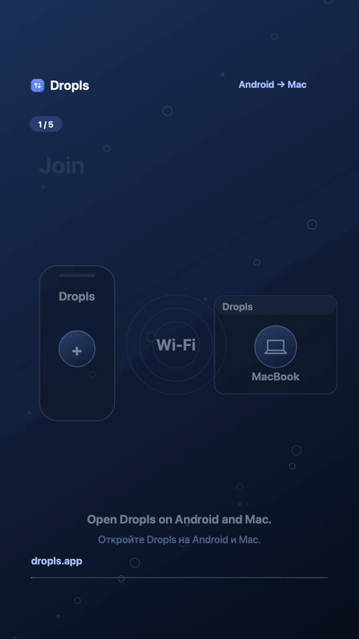
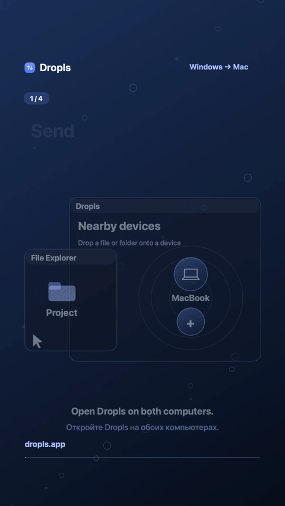

# Dropls

Pair your devices once. Send files between Android, Mac, and Windows without confirming every transfer.

[**Android APK**](https://github.com/Beloshapkins/dropls-releases/releases/download/dropls-preview-2026-11/Dropls-Android-0.9.9.apk) · [**macOS DMG**](https://github.com/Beloshapkins/dropls-releases/releases/download/dropls-preview-2026-11/Dropls-Mac-0.9.8-arm64.dmg) · [**Windows EXE**](https://github.com/Beloshapkins/dropls-releases/releases/download/dropls-preview-2026-11/Dropls-Windows-0.9.8-x64-Setup.exe)

**Drop it. Please.**  
**Fewer steps. More life.**

I use Dropls every day. I wanted to spend less time moving files between my devices. On a Mac, I can drop a folder onto a device bubble and get back to what I was doing. If you shoot on Android, Dropls can send new clips to a paired computer while you keep filming.

Dropls sends files and folders between Android, macOS, and Windows over your local network. No account or cloud upload required. The app is available in English and Russian. I originally released it as LocalDrop.

[Download Dropls](https://github.com/Beloshapkins/dropls-releases/releases/tag/dropls-preview-2026-11) · [Official website](https://dropls.app) · [Instagram @dropls.app](https://www.instagram.com/dropls.app/)

## Pair once. Send whenever you need.

Compare the pairing code on both screens the first time you connect two devices. Dropls remembers them as trusted devices. After that, send as many files or folders as you need between them. There’s no approval prompt for each send or receive.

### Send your first file from Android to Mac

Open Dropls on both devices on the same local network. Pick a file on Android and tap your Mac. Check that the pairing code matches on both screens. Once paired, the two devices can send and receive files without another approval prompt.

## What you can do with Dropls

- **Send a whole project folder.** On Mac or Windows, drop the folder onto the receiving device’s bubble. Dropls keeps the folder structure and shows one progress bar for the transfer.
- **Keep filming while clips go to your Mac.** Turn on camera auto-upload on Android and choose your paired Mac. When the Mac is reachable on the same network, new camera photos and videos arrive in its receive folder. A separate editing agent can watch that folder and turn the clips into a draft Story for you to review.
- **Back up the folders you work in every day.** Pair your devices once. Whenever you want a backup, drop the folder onto the receiving device’s bubble in Dropls on Mac or Windows. The folder arrives with its structure intact.
- **Get a build onto your test phone.** On Mac or Windows, connect Dropls to an MCP client. After a build, ask your agent to send the APK you choose to your paired Android phone and report when it arrives.

## Latest update — November 18, 2026

Android **0.9.9** · macOS **0.9.8** · Windows **0.9.8**

- **Energy saving mode.** Turn it on from the main screen or Settings. Dropls reduces periodic device discovery in the background and resumes searching when you open the app. The mode is off by default.
- **Receiving stays available** while your device is awake and the operating system allows network access.
- **Android camera uploads** look for the paired Mac when a new file needs to be sent. If the Mac is unavailable, the file stays queued.
- **Android controls and readability.** The energy saving switch sits in the top bar beside refresh and Settings. Tap the battery icon for help. This update also fixes text contrast in dark mode.

[Release notes and installers](https://github.com/Beloshapkins/dropls-releases/releases/tag/dropls-preview-2026-11)

## Downloads

| Platform | Version | Requirements | Installer |
| --- | --- | --- | --- |
| Android | 0.9.9 | Android 10 or later | [APK](https://github.com/Beloshapkins/dropls-releases/releases/download/dropls-preview-2026-11/Dropls-Android-0.9.9.apk) |
| Mac | 0.9.8 | macOS 13 or later, Apple silicon | [DMG](https://github.com/Beloshapkins/dropls-releases/releases/download/dropls-preview-2026-11/Dropls-Mac-0.9.8-arm64.dmg) |
| Windows | 0.9.8 | Windows 10 or 11, x64 | [EXE](https://github.com/Beloshapkins/dropls-releases/releases/download/dropls-preview-2026-11/Dropls-Windows-0.9.8-x64-Setup.exe) |

## Send your first file

1. Install and open Dropls on both devices. Connect them to the same local network.
2. On the sending device, choose a file and tap or click the receiving device.
3. When pairing for the first time, compare the code on both screens and confirm that it matches.
4. Open the received file on the other device.

## Early builds

Android uses a debug-signed APK installed outside Google Play. The Mac build uses a local signature and is not notarized. The Windows installer has no Authenticode signature. Your device may show an installation warning. Download only from the official release page and use the SHA-256 checksums to verify the files.

## Feedback

If a transfer stalls, tell me which devices and OS versions you used, and whether the issue happened during discovery, pairing, or transfer. [Contact the creator](https://t.me/beloshapkins).

Dropls is proprietary software developed and maintained by its creator. This repository distributes installers and user documentation. All rights reserved.
